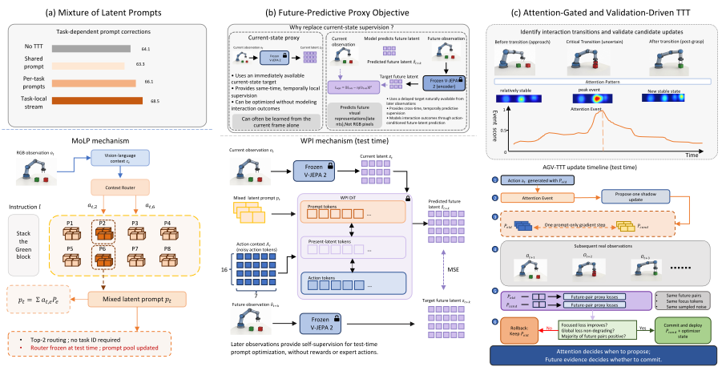

<div align="center">

# VANE

### Reliable Test-Time Training for Vision-Language-Action Models via Future Visual Representation Prediction

Hongjin Ji<sup>1,5,*</sup>&nbsp;&nbsp; Guoyang Xia<sup>2,5,*</sup>&nbsp;&nbsp; Luoyang Sun<sup>3,4,5,*</sup>&nbsp;&nbsp; Fangxiang Feng<sup>2</sup>&nbsp;&nbsp; Lei Ren<sup>5,†,‡</sup>

<sup>1</sup>The Chinese University of Hong Kong, Shenzhen&nbsp;&nbsp;
<sup>2</sup>Beijing University of Posts and Telecommunications  
<sup>3</sup>Institute of Automation, Chinese Academy of Sciences&nbsp;&nbsp;
<sup>4</sup>University of Chinese Academy of Sciences&nbsp;&nbsp;
<sup>5</sup>Li Auto Inc.

<sup>*</sup>Equal contribution&nbsp;&nbsp; <sup>†</sup>Project leader&nbsp;&nbsp; <sup>‡</sup>Corresponding author

[](https://arxiv.org/abs/2608.09448v2)
[](report/VANE.pdf)
[](https://mindvla-team.github.io/VANE/)
[](LICENSE)

</div>

<p align="center">
  <a href="assets/vane_overview.pdf"></a>
</p>

## TL;DR

VANE is a reliable test-time training framework for vision-language-action models. It uses a context-routed prompt bank to represent task-dependent corrections, future visual representations as label-free supervision, and a proposal-validation-commit protocol that keeps candidate updates away from the live controller until future evidence supports them.

On SimplerEnv WidowX, VANE reaches **71.2%** average success, improving by **3.2 percentage points** over the corresponding TTT baseline. In the single-prompt QwenWPI study, AGV-TTT reduces backward updates by **98.7%** relative to dense Online TTT.

## Highlights

- **Mixture of Latent Prompts (MoLP):** composes a context-dependent prompt from a shared prompt bank without an external task identifier.
- **World-Predictive Interface (WPI):** predicts delayed visual representations from current observations, prompt context, and actions, using later observations as label-free targets.
- **Attention-Gated and Validation-Driven TTT (AGV-TTT):** creates sparse shadow updates at attention transitions and deploys them only after matched future validation.
- **Selective and reversible adaptation:** prompt parameters and optimizer state are committed atomically or discarded together.

## Method

VANE treats deployment-time adaptation as a sequence of three decisions:

| Decision | Component | Role |
|---|---|---|
| Route the correction | **MoLP** | Routes the current vision-language context over a shared latent-prompt bank. |
| Predict the consequence | **WPI** | Predicts future visual latents obtained from ordinary robot interaction. |
| Validate before deployment | **AGV-TTT** | Proposes in shadow, validates on later observations, then commits or rolls back. |

At deployment, the policy, router, visual encoder, and predictive modules remain frozen. Only the latent-prompt bank is eligible for validated updates.

## Main Results

### SimplerEnv WidowX

| Method | Carrot | Eggplant | Spoon | Cube | Overall |
|---|---:|---:|---:|---:|---:|
| TTT-VLA (π0.5 + SG-LP + TTT) | 74.5 | 76.0 | 71.0 | 48.0 | 67.4 |
| QwenPi + SG-LP + TTT | 58.0 | 95.6 | 83.9 | 18.2 | 63.9 |
| QwenPi + MoLP + AGV-TTT | 64.6 | **97.1** | **84.9** | 28.4 | 68.8 |
| QwenWPI + FP-LP + TTT | 63.1 | 90.2 | 73.9 | **44.9** | 68.0 |
| **QwenWPI + MoLP + AGV-TTT** | **68.8** | 94.5 | 77.3 | 44.3 | **71.2** |

Cross-system comparisons do not isolate backbone, training-data, or adaptation effects. See the paper for controlled component comparisons.

### Optimization Efficiency

| Protocol | Backward passes | Validation forwards | Success |
|---|---:|---:|---:|
| Online TTT | 45,824 | — | 67.5 |
| **AGV-TTT** | **612** | 4,831 | **69.0** |

AGV-TTT triggers backward optimization on only 1.3% of eligible frames. Only 19.4% of proposals are accepted, so most candidates never enter the deployed policy.

## Scope

VANE's gains remain task- and embodiment-dependent. On the common three-task Google Robot scope, QwenPi improves from 71.7% to 76.7%, while QwenWPI decreases from 73.6% to 72.4%. On the complete four-task scope, QwenPi improves from 70.7% to 71.7% and QwenWPI improves from 64.6% to 70.4%. The benefit therefore depends on task composition, so we treat Google Robot as a boundary and scope test rather than evidence of universal dominance. Full task-level VM/VA results appear in Tables 4–5 of the paper.

## Project Page

This repository hosts the paper, figures, and static project website. The website is implemented with dependency-free HTML, CSS, and JavaScript and can be served directly through GitHub Pages.

To preview locally:

```bash
python3 -m http.server 8000
```

Then open `http://localhost:8000`.

## Citation

```bibtex
@article{ji2026vane,
  title   = {VANE: Reliable Test-Time Training for Vision-Language-Action
             Models via Future Visual Representation Prediction},
  author  = {Ji, Hongjin and Xia, Guoyang and Sun, Luoyang and
             Feng, Fangxiang and Ren, Lei},
  journal = {arXiv preprint arXiv:2608.09448},
  year    = {2026}
}
```

## License

Released under the [Apache License 2.0](LICENSE). Copyright 2026 Li Auto Inc. See [NOTICE](NOTICE) for details.
